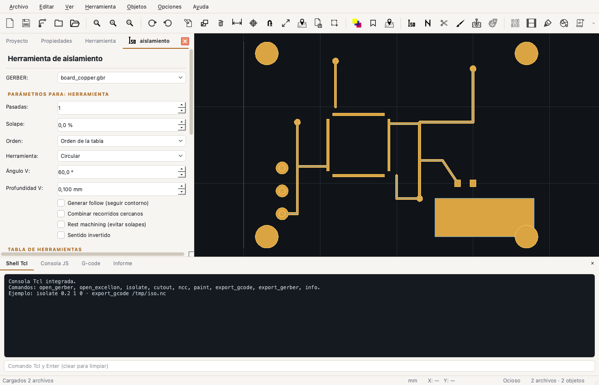
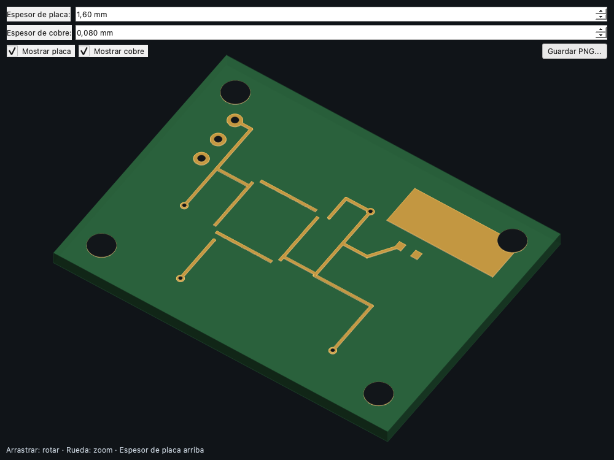
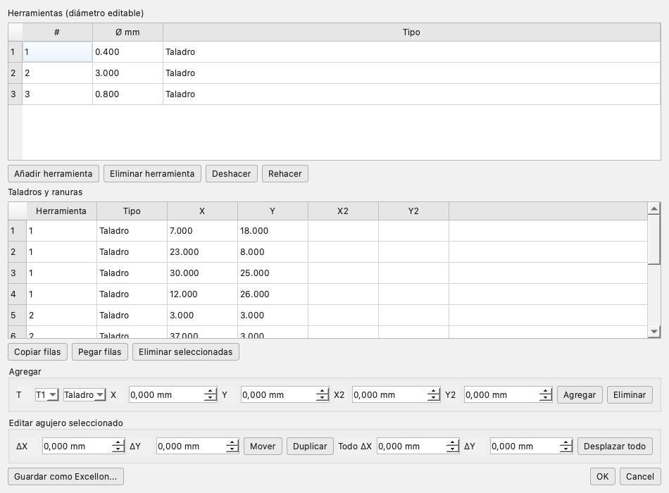
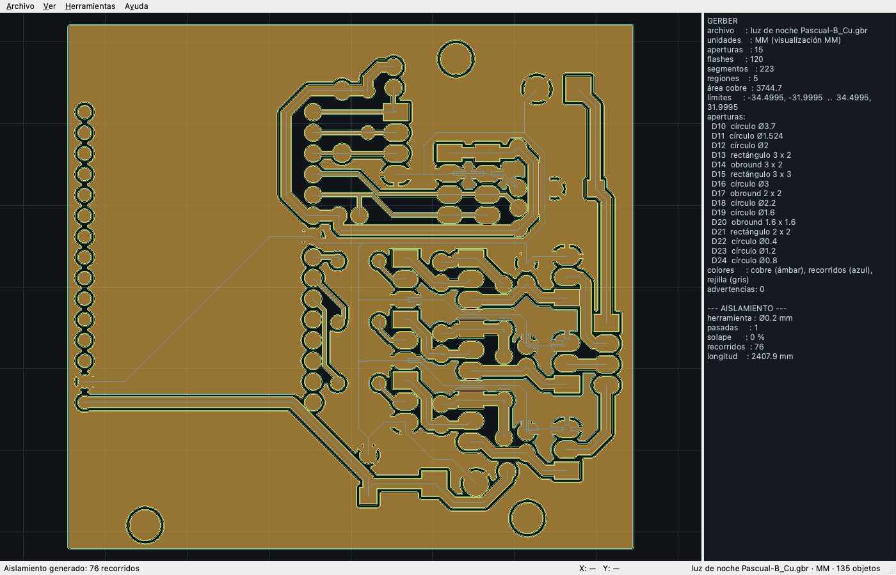

<p align="right"><a href="README_US.md">🇬🇧 English</a> | <a href="README.md">🇪🇸 Español</a></p>

<p align="center">
  
</p>

<h1 align="center">FlatCAM C++</h1>

<p align="center">
  Port nativo de <strong>FlatCAM 2024.4</strong> a C++20, Qt 6 y GEOS para fabricar placas de circuito impreso.
</p>

<p align="center">
  <a href="https://github.com/dnasta/FlatCAM_Cpp/releases/tag/v0.02"></a>
  <a href="LICENSE"></a>
  
  
  
</p>

<p align="center">
  <a href="README_US.md">🇬🇧 English</a> ·
  <a href="https://dnasta.github.io/FlatCAM_Cpp/manual_html/index.html"><strong>📖 Manual de usuario</strong></a> ·
  <a href="https://dnasta.github.io/FlatCAM_Cpp/manual_cpp/index.html"><strong>🛠 Manual del código</strong></a> ·
  <a href="https://github.com/dnasta/FlatCAM_Cpp/releases/tag/v0.02"><strong>⬇ Descargar v0.02</strong></a>
</p>

---

## Índice

- [Qué es FlatCAM C++](#qué-es-flatcam-c)
- [Capturas](#capturas)
- [Características](#características)
- [Formatos soportados](#formatos-soportados)
- [Herramientas CAM](#herramientas-cam)
- [Instalación en macOS](#instalación-en-macos)
- [Inicio rápido](#inicio-rápido)
- [Línea de comandos](#línea-de-comandos)
- [Automatización](#automatización)
- [Compilar desde el código fuente](#compilar-desde-el-código-fuente)
- [Tests y verificación](#tests-y-verificación)
- [Estructura del proyecto](#estructura-del-proyecto)
- [Manual de usuario](#manual-de-usuario)
- [Manual del código](#manual-del-código)
- [Licencia](#licencia)
- [Autoría y linaje](#autoría-y-linaje)
- [Créditos](#créditos)

---

## Qué es FlatCAM C++

FlatCAM C++ convierte los archivos de diseño de una PCB —capas **Gerber** y taladros **Excellon**— en programas **G-code** para una fresadora CNC, un router o una máquina láser.

Es un port del FlatCAM original (Python + PyQt5) a **C++20**, con **Qt 6** para la interfaz y **GEOS** para la geometría. Conserva el flujo de trabajo y las herramientas del original, pero elimina la dependencia de Python, numpy o shapely en tiempo de ejecución.

**En una frase:** importás tu placa, elegís la fresa, previsualizás los recorridos y exportás el G-code.

### Por qué un port nativo

| Aspecto | FlatCAM original | FlatCAM C++ |
|---|---|---|
| Runtime | Python + PyQt5 + shapely + numpy | Binario nativo |
| Arranque | Depende del entorno Python | Inmediato |
| Geometría | shapely (GEOS desde Python) | GEOS C API directa |
| Distribución | Requiere instalar dependencias | `.app` autocontenida |
| Scripting | Tcl | Tcl + JavaScript (QJSEngine) |
| Interfaz | Qt5 | Qt6 |

---

## Capturas

<p align="center">
  
  <br><em>Interfaz principal con el panel de aislamiento y el visor de cobre.</em>
</p>

<p align="center">
  
  <br><em>Vista 3D con cobre extruido, placa y taladros.</em>
</p>

<p align="center">
  
  <br><em>Editor Excellon: herramientas, taladros y ranuras.</em>
</p>

<p align="center">
  
  <br><em>Placa real mecanizada y verificada contra el G-code de producción.</em>
</p>

---

## Características

### Importación

- **Gerber RS-274X**: formato `FS`, unidades `MO`/`G70`/`G71`, aperturas `C/R/O/P`, macros `AM`, trazos `D01/D02/D03`, arcos `G02/G03`, regiones `G36/G37`, polaridad `LP`, step & repeat `SR`.
- **Excellon**: cabecera `M48`, unidades y formato, herramientas, taladros, ranuras `G85`, ruteo `M15/M16`, repeticiones `R`, archivos sin cabecera.
- **G-code**: visor de programas existentes.
- **SVG**: paths, polígonos, rectángulos, círculos, elipses, líneas, curvas C/Q/S/T/A, transformaciones de grupos y **texto** convertido a contornos.
- **DXF**: LINE, LWPOLYLINE, CIRCLE, ARC, ELLIPSE, SPLINE, bloques **INSERT** con escala/rotación/arrays y **TEXT/MTEXT**.
- **HPGL2**: `SC`, `PA/PR`, `PU/PD`, `CI`, `AA/AR`, `EA/ER`, `RA/RR`.
- **PDF**: importación **vectorial** (trazos, rellenos, Bézier, CTM) y rasterizado multipágina con PDFKit como fallback.
- **Imágenes**: PNG/JPG por umbral, color objetivo o máscara, con ancho o DPI.
- **Proyectos** `.FlatPrj`: JSON con geometría, tablas, propiedades y scripts; soporta lzma y lectura en streaming.

### Herramientas CAM

- **Aislamiento**: pasadas, solape, V-shape, herramienta bola, follow, combine, rest machining, orden y sentido.
- **Perforación**: taladros y ranuras desde Excellon, peck, offsets, orden optimizado y TSP exacto hasta 18 puntos.
- **Corte de contorno**: margen, puentes/tabs, corte completo, agujeros internos y multipasada.
- **NCC**: hatch o paint, superposición, distancia al cobre, margen, ángulo, área, conexión y rest.
- **Pintura**: relleno por contornos paralelos.
- **Fresado**: sigue los recorridos del Gerber.
- **Copper Thieving**: puntos, cuadrados o líneas, PPM y referencia.
- **Film**: positivo, negativo, punched, marco, skew y referencia.
- **Panelizado**: grilla, fila o columna, separación, fillet y referencia.
- **Solder Paste**: boquillas por tamaño de pad, Z de dosificación, pausa y dirección.
- **QR Code**: texto, módulo, borde, ECC y exportación.
- **Punch Gerber** y **Extraer taladros**.
- **Marcas de esquina**, **fiduciales**, **herramienta óptima**, **reglas**, **calibración**, **distancia mínima**, **alinear**, **doble faz**, **compensación**, **invertir**.

### Editores

- **Gerber**: primitivas, selección múltiple, mover/duplicar/eliminar, rotar/escalar, agregar círculo/rectángulo/línea/arco, booleanas, simplificar, buffer, aperturas y macros.
- **Excellon**: herramientas, taladros/ranuras, mover, duplicar, copiar/pegar, desplazar todo y guardar.
- **Geometría**: contornos, agujeros, vértices, undo/redo y operaciones.
- **G-code**: resaltado de sintaxis.
- **Fuente**: edita el Gerber/Excellon original y reprocesa.

### Interfaz

- Árbol de proyecto con grupos **Archivos**, **Herramientas** y **G-code**.
- Columna **Vis** con iconos, propiedades por objeto y tablas de herramientas por operación.
- Canvas con zoom/pan, selección, medición, rejilla, snap, unidades **mm/in** y colores.
- **Vista 3D** con cobre extruido, placa, taladros, iluminación por cara y exportación PNG.
- Nivel **BASIC/ADVANCED**.
- Tema claro/oscuro, iconos originales de FlatCAM y globos explicativos.
- Consola inferior con **Shell Tcl**, **Consola JS**, **G-code** e **Informe**.

### Automatización

- **71 comandos Tcl** integrados.
- **API JavaScript** con `QJSEngine`.
- **CLI** `flatcam-cli` y ejecutable `flatcam-js`.
- Scripts de proyecto guardados dentro del `.FlatPrj`.

---

## Formatos soportados

| Formato | Importar | Exportar | Notas |
|---|:---:|:---:|---|
| Gerber RS-274X | ✅ | ✅ | Aperturas, macros, regiones, polaridad, SR |
| Excellon | ✅ | ✅ | Taladros, ranuras, ruteo |
| G-code | ✅ | ✅ | 18 preprocesadores |
| SVG | ✅ | ✅ | Curvas, grupos, texto |
| DXF | ✅ | ✅ | Bloques, arrays, TEXT/MTEXT, splines |
| HPGL2 | ✅ | ✅ | SC, arcos, rectángulos |
| PDF | ✅ | ✅ | Vectorial y raster multipágina |
| PNG / JPG | ✅ | ✅ | Vectorización y capturas |
| `.FlatPrj` | ✅ | ✅ | JSON, lzma opcional |

---

## Herramientas CAM

| Herramienta | Qué hace | Parámetros principales |
|---|---|---|
| Aislamiento | Separa el cobre | Pasadas, solape, V-shape, follow, combine, rest |
| Perforación | Taladros y ranuras | Peck, offsets, orden, TSP |
| Corte | Separa la placa | Margen, puentes, multipasada, agujeros |
| NCC | Remueve cobre sobrante | Hatch/paint, superposición, clearance, margen |
| Pintura | Rellena áreas | Superposición, margen, conectores |
| Fresado | Sigue recorridos | Diámetro, Z, avance |
| Thieving | Grilla de cobre | Diámetro, separación, PPM, patrón |
| Film | Combina capas | Margen, negativo, punched, skew |
| Panelizado | Repite la placa | Filas, columnas, gap, fillet |
| Solder Paste | Dosifica pasta | Boquillas, Z, pausa |
| QR | Genera un QR | Texto, módulo, borde, ECC |
| Punch / Extraer | Utilidades de taladros | Margen, Ø máximo |
| Reglas / Óptima | Análisis | Separación, traza, anillo, Ø máximo |
| Calibración | Corrige escala | Distancia medida/real, dos puntos |

---

## Instalación en macOS

### Requisitos

- **macOS 14.4 o superior**
- **Apple Silicon** (arm64)
- 200 MB de disco

### Desde el DMG

1. Descargá [`FlatCAM-CPP-0.2.0-arm64.dmg`](https://github.com/dnasta/FlatCAM_Cpp/releases/tag/v0.02).
2. Abrí el DMG.
3. Arrastrá **FlatCAM C++** a *Aplicaciones*.
4. La primera vez: clic derecho → **Abrir** (firma ad-hoc).

El DMG incluye Qt, GEOS, zlib y las licencias. No requiere Homebrew.

### CLI incluida

```bash
"/Applications/FlatCAM C++.app/Contents/MacOS/flatcam-cli" --help
"/Applications/FlatCAM C++.app/Contents/MacOS/flatcam-js" script.js
```

---

## Inicio rápido

```text
1. Archivo → Abrir  →  board_copper.gbr + board.drl
2. Herramienta → Aislamiento
   Ø 0.2 mm · 1 pasada · solape 10 % · Z −0.10 mm
3. Previsualizar → Generar CNCJob → Guardar G-code
4. Herramienta → Perforación
   Revisar tabla del Excellon · Z −1.8 mm · peck 0.5 mm
5. Herramienta → Corte
   Ø 1.5 mm · margen 0.5 mm · 4 puentes · Z −1.8 mm
6. Ver → Vista 3D para revisar el resultado
```

> **Antes de mecanizar:** simulá el G-code, verificá el cero de la pieza y la altura Z. Un error de 0,1 mm puede arruinar la placa.

---

## Línea de comandos

```bash
# Geometría
flatcam-cli gerber examples/board_copper.gbr --json
flatcam-cli excellon examples/board.drl --json

# Aislamiento
flatcam-cli isolate examples/board_copper.gbr \
  --tool-dia 0.2 --passes 2 --overlap 10 -o iso.nc

# Corte con puentes
flatcam-cli cutout examples/board_outline.gbr \
  --tool-dia 1.5 --margin 0.5 --tabs 4 --tab-width 3 -o cut.nc

# NCC
flatcam-cli ncc examples/board_copper.gbr \
  --tool-dia 0.5 --superposition 80 -o ncc.nc

# Taladrado optimizado
flatcam-cli gcode examples/board.drl \
  --preprocessor grbl --optimize -o drill.nc

# Proyecto
flatcam-cli project examples/demo.FlatPrj --info
```

---

## Automatización

### Tcl

```tcl
open_gerber examples/board_copper.gbr
isolate 0.2 2 15
export_gcode /tmp/board_iso.nc
```

Hay 71 comandos: apertura, herramientas, objetos, geometría, exportación y sistema. La lista completa está en el [manual](https://dnasta.github.io/FlatCAM_Cpp/automatizacion.html).

### JavaScript

```js
flatcam.openGerber("examples/board_copper.gbr");
flatcam.isolate(0.2, 2, 15);
flatcam.exportGcode("/tmp/board_iso.nc");
flatcam.log(flatcam.info());
```

### CLI

```bash
flatcam-cli tcl                    # REPL Tcl
flatcam-js script.js               # ejecutar JavaScript
flatcam-cli isolate ... -o out.nc  # tareas puntuales
```

---

## Compilar desde el código fuente

### Dependencias

| Dependencia | Uso |
|---|---|
| CMake ≥ 3.25 | Configuración y build |
| Compilador C++20 | AppleClang, GCC o MSVC |
| Qt 6.4+ | GUI, SVG, impresión, SQL, QML |
| GEOS ≥ 3.9 | Geometría |
| zlib | PDF comprimido |
| Tcl | Consola embebida (opcional) |
| GoogleTest | Tests |

### macOS

```bash
brew install cmake geos googletest
# Qt 6: instalador oficial en ~/Qt o brew install qt

cmake -S . -B build \
  -DCMAKE_BUILD_TYPE=Release \
  -DCMAKE_PREFIX_PATH="$HOME/Qt/6.12.0/macos"
cmake --build build -j8

# Tests
./build/flatcam_tests
./build/flatcam_gui_tests

# App
./build/flatcam-gui.app/Contents/MacOS/flatcam-gui
```

### Empaquetar el DMG

```bash
./tools/create_dmg.sh 0.2.0
# dist/FlatCAM-CPP-0.2.0-arm64.dmg
```

El script compila, ejecuta `macdeployqt`, copia GEOS, incrusta licencias, firma ad-hoc y crea el DMG con la app renombrada a `FlatCAM C++.app`.

### Linux y Windows

El código es portable y CMake detecta GEOS por pkg-config o por configuración. Todavía no hay instaladores oficiales:

- **Linux:** `libgeos-dev`, `zlib1g-dev`, Qt 6, Tcl; `cmake` y `ninja`.
- **Windows:** Qt 6 MSVC, GEOS por vcpkg, zlib y Tcl opcional; Visual Studio 2022.

---

## Tests y verificación

```bash
./build/flatcam_tests        # 88 tests de núcleo
./build/flatcam_gui_tests    # 7 tests de GUI
```

Cobertura principal:

- Geometría GEOS, uniones, buffers, agujeros y transformaciones.
- Gerber y Excellon contra el parser original.
- Aislamiento, corte, NCC, pintura, taladrado y G-code.
- Importadores SVG, DXF, HPGL2 y PDF.
- Proyecto `.FlatPrj`, tablas y round-trip.
- Texto SVG, bloques DXF, unidades y `UnitSpinBox`.

Verificación con una placa real:

- 5 capas Gerber coincidentes con FlatCAM.
- Excellon PTH: 120 taladros en 4 herramientas.
- Corte: 266,7257 mm vs 266,7255 mm del G-code de producción.
- Taladrado: 84/29/4/3 taladros por herramienta.
- Proyecto lzma de 1,59 GiB leído en streaming.

---

## Estructura del proyecto

```text
include/flatcam/        API pública del núcleo
src/core/               Geometría, importadores, proyecto, unidades
src/parsers/            Gerber y Excellon
src/cam/                G-code, aislamiento, corte, NCC, pintura, thieving
src/gui/                Qt: ventana, canvas, 3D, editores, texto
src/script/             API JavaScript (QJSEngine)
src/cli/                CLI y Tcl embebido
tests/                  GoogleTest + datos de prueba
examples/               Placa de demostración y proyecto
assets/                 Iconos, logo y social preview
docs/manual_html/       Manual de usuario (HTML estático)
tools/                  Scripts de empaquetado y verificación
third_party/            nlohmann/json, QR
licenses/               Licencias de terceros
```

---

## Manual de usuario

El manual cubre en detalle:

- Instalación, interfaz y proyecto.
- Importación/exportación de todos los formatos.
- Aislamiento, perforación, corte, NCC y pintura.
- Herramientas especiales.
- Preferencias y unidades.
- Automatización con Tcl/JS/CLI.
- Atajos, diagnóstico y glosario.

**Online:** <https://dnasta.github.io/FlatCAM_Cpp/manual_html/index.html>

**En el repositorio:** [`docs/manual_html/index.html`](docs/manual_html/index.html)

---

## Manual del código

Documentación Doxygen de clases, módulos y API interna:

**Online:** <https://dnasta.github.io/FlatCAM_Cpp/manual_cpp/index.html>

**En el repositorio:** [`docs/manual_cpp/index.html`](docs/manual_cpp/index.html)

**Generar localmente:**

```bash
doxygen Doxyfile
open docs/manual_cpp/index.html
```

---

## Licencia

FlatCAM C++ se distribuye bajo **GNU General Public License v3.0**. Ver [`LICENSE`](LICENSE).

Es un port de **FlatCAM 2024.4**, publicado originalmente bajo GPLv3 por Juan Pablo Caram y colaboradores. Los componentes de terceros y sus licencias están en [`THIRD_PARTY_NOTICES.md`](THIRD_PARTY_NOTICES.md).

---

## Autoría y linaje

Este proyecto es un port en C++ de una cadena de versiones de FlatCAM:

1. **FlatCAM original** — creado por **Juan Pablo Caram**.
   Copyright 2014–2019, Juan Pablo Caram.
   <https://bitbucket.org/jpcgt/flatcam/src/master/>
2. **FlatCAM BETA** — (c) 2019 by **Marius Stanciu**.
   <https://github.com/MariusAdrian88/FlatCAM_Evo>
3. **FlatCAM β 2024.4** — (c) 2024, proyecto de **vika-sonne**.
   <https://github.com/vika-sonne/FlatCAM/>
4. **FlatCAM C++** — port nativo de la versión 2024.4 a C++20 con Qt 6 y GEOS.

Se conserva la licencia **GPLv3** y el reconocimiento a todos los autores de la
cadena original.

## Créditos

- **FlatCAM original:** Juan Pablo Caram y colaboradores.
- **FlatCAM BETA:** Marius Stanciu.
- **FlatCAM β 2024.4:** vika-sonne y colaboradores.
- **GEOS:** OSGeo.
- **Qt:** The Qt Company.
- **nlohmann/json:** Niels Lohmann.
- **QR Code generator:** Project Nayuki.
- **Comunidad FlatCAM** por la documentación y los ejemplos.

<p align="center"><sub>Hecho con C++20, Qt 6 y GEOS · macOS Apple Silicon · v0.02</sub></p>
