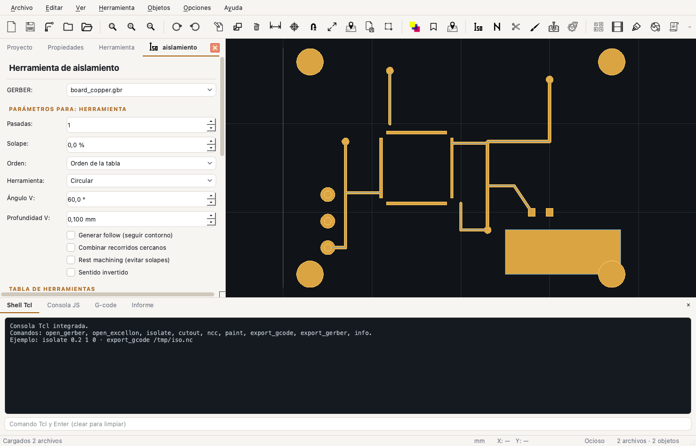
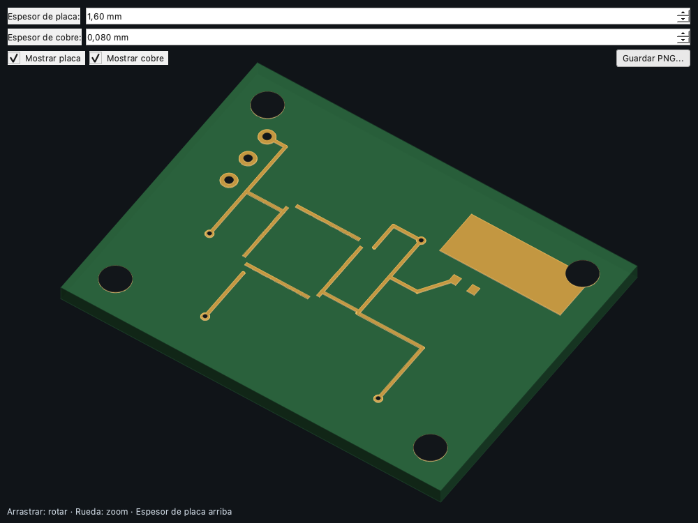
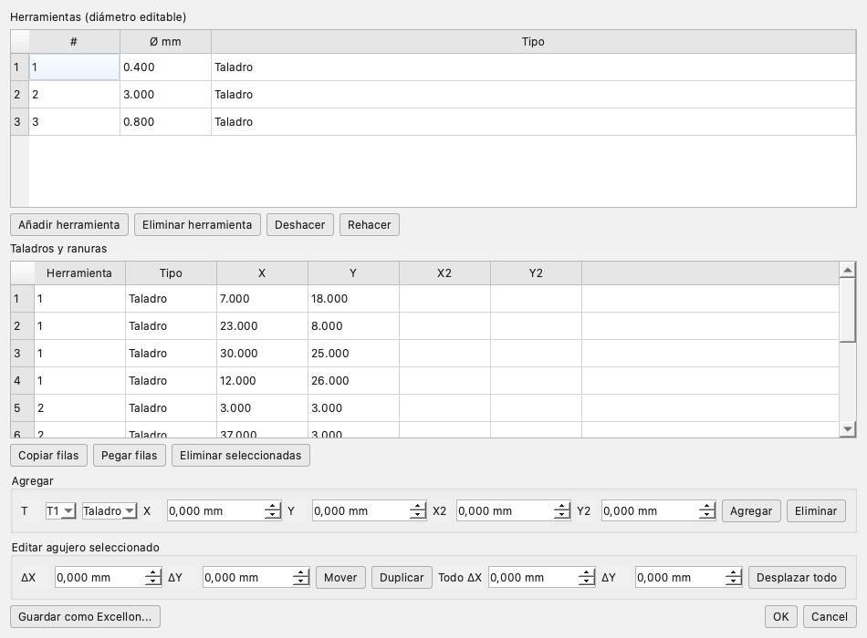
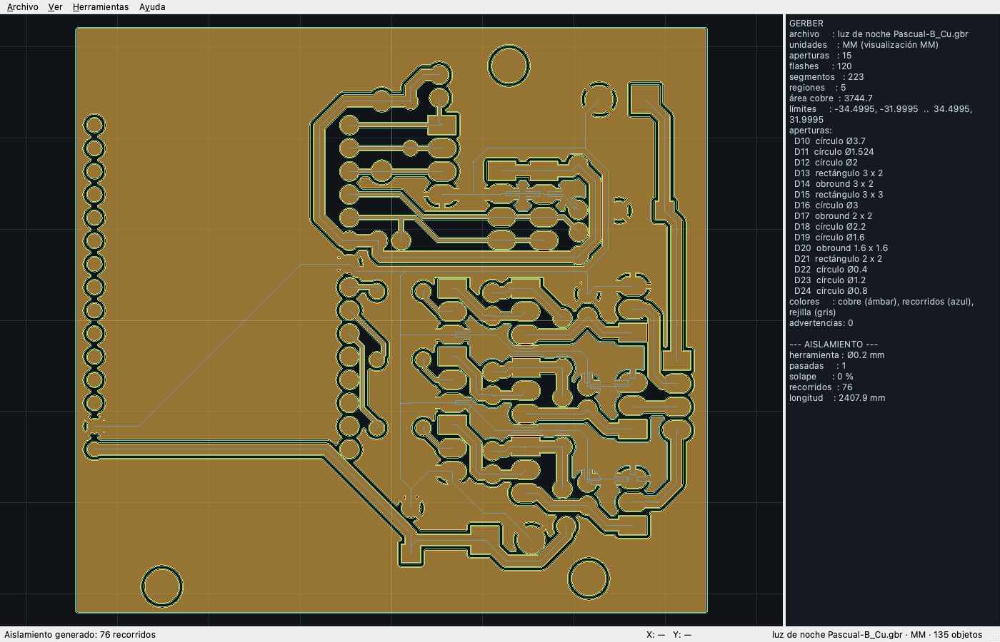

<p align="right"><a href="README_US.md">🇬🇧 English</a> | <a href="README.md">🇪🇸 Español</a></p>

<p align="center">
  
</p>

<h1 align="center">FlatCAM C++</h1>

<p align="center">
  Native port of <strong>FlatCAM 2024.4</strong> to C++20, Qt 6 and GEOS for PCB fabrication.
</p>

<p align="center">
  <a href="https://github.com/dnasta/FlatCAM_Cpp/releases/tag/v0.3.1"></a>
  <a href="LICENSE"></a>
  
  
  
</p>

<p align="center">
  <a href="https://dnasta.github.io/FlatCAM_Cpp/manual_html/index.html"><strong>📖 User manual</strong></a> ·
  <a href="https://dnasta.github.io/FlatCAM_Cpp/manual_cpp/index.html"><strong>🛠 Code manual</strong></a> ·
  <a href="https://github.com/dnasta/FlatCAM_Cpp/releases/tag/v0.3.1"><strong>⬇ Download v0.3.1</strong></a>
</p>

---

## Contents

- [What is FlatCAM C++?](#what-is-flatcam-c)
- [Screenshots](#screenshots)
- [Features](#features)
- [Supported formats](#supported-formats)
- [CAM tools](#cam-tools)
- [macOS installation](#macos-installation)
- [Quick start](#quick-start)
- [Command line](#command-line)
- [Automation](#automation)
- [Building from source](#building-from-source)
- [Tests and verification](#tests-and-verification)
- [Project layout](#project-layout)
- [User manual](#user-manual)
- [Code manual](#code-manual)
- [License](#license)
- [Authorship and lineage](#authorship-and-lineage)

---

## What is FlatCAM C++?

FlatCAM C++ converts PCB design files —**Gerber** copper layers and **Excellon** drill files— into **G-code** for a CNC mill, router or laser.

It is a port of the original FlatCAM (Python + PyQt5) to **C++20**, using **Qt 6** for the UI and **GEOS** for geometry. It keeps the original workflow and tools while removing the Python, numpy and shapely runtime dependencies.

**In one sentence:** import your board, pick the tool, preview the toolpaths and export G-code.

### Why a native port?

| Aspect | Original FlatCAM | FlatCAM C++ |
|---|---|---|
| Runtime | Python + PyQt5 + shapely + numpy | Native binary |
| Startup | Depends on the Python environment | Immediate |
| Geometry | shapely (GEOS through Python) | GEOS C API |
| Distribution | Requires installing dependencies | Self-contained `.app` |
| Scripting | Tcl | Tcl + JavaScript (QJSEngine) |
| UI | Qt5 | Qt6 |

---

## Screenshots

<p align="center">
  
  <br><em>Main window with the isolation panel and the copper viewer.</em>
</p>

<p align="center">
  
  <br><em>3D view with extruded copper, board and drills.</em>
</p>

<p align="center">
  
  <br><em>Excellon editor: tools, drills and slots.</em>
</p>

<p align="center">
  
  <br><em>Real board machined and verified against production G-code.</em>
</p>

---

## Features

### Import

- **Gerber RS-274X**: `FS`, `MO`/`G70`/`G71`, `C/R/O/P` apertures, `AM` macros, `D01/D02/D03` strokes, `G02/G03` arcs, `G36/G37` regions, `LP` polarity, `SR` step & repeat.
- **Excellon**: `M48` header, units and format, tools, drills, `G85` slots, `M15/M16` routing, `R` repeats, headerless files.
- **G-code**: viewer for existing programs.
- **SVG**: paths, polygons, rectangles, circles, ellipses, lines, C/Q/S/T/A curves, group transforms and **text** converted to outlines.
- **DXF**: LINE, LWPOLYLINE, CIRCLE, ARC, ELLIPSE, SPLINE, **INSERT** blocks with scale/rotation/arrays and **TEXT/MTEXT**.
- **HPGL2**: `SC`, `PA/PR`, `PU/PD`, `CI`, `AA/AR`, `EA/ER`, `RA/RR`.
- **PDF**: **vector** import (paths, fills, Bézier, CTM) plus multipage rasterization with PDFKit as fallback.
- **Images**: PNG/JPG by threshold, target color or mask, with width or DPI.
- **Projects** `.FlatPrj`: JSON with geometry, tables, properties and scripts; lzma and streaming reads.

### CAM tools

- **Isolation**: passes, overlap, V-shape, ball tool, follow, combine, rest machining, order and direction.
- **Drilling**: drills and slots from Excellon, peck, offsets, optimized order and exact TSP up to 18 holes.
- **Cutout**: margin, tabs by side or manual positions, full cut, internal holes and multipass.
- **NCC**: hatch or paint, overlap, copper clearance, margin, angle, area, connection and rest.
- **Paint**: contour-parallel fill.
- **Milling**: follows Gerber paths.
- **Copper thieving**: dots, squares or lines, PPM and reference.
- **Film**: positive, negative, punched, frame, skew and reference.
- **Panelize**: grid, row or column, gap, fillet and reference.
- **Solder paste**: nozzles per pad size, dispense Z, dwell and direction.
- **QR Code**: text, module, border, ECC and export.
- **Punch Gerber** and **Extract drills**.
- **Corner marks**, **fiducials**, **optimal tool**, **rules**, **calibration**, **minimum distance**, **align**, **double-sided**, **compensation**, **invert**.

### Editors

- **Gerber**: primitives, multi-select, move/duplicate/delete, rotate/scale, add circle/rectangle/line/arc, booleans, simplify, buffer, apertures and macros.
- **Excellon**: tools, drills/slots, move, duplicate, copy/paste, shift all and save.
- **Geometry**: contours, holes, vertices, undo/redo and operations.
- **G-code**: syntax highlighting.
- **Source**: edit the original Gerber/Excellon and reprocess it.

### UI

- Project tree with **Files**, **Tools** and **G-code** groups.
- **Vis** column, per-object properties and per-operation tool tables.
- Canvas with zoom/pan, selection, measurement, grid, snap, **mm/in** units and colors.
- **3D view** with extruded copper, board, drills, per-face lighting and PNG export.
- **BASIC/ADVANCED** level.
- **Four themes** in `Options → Themes`: Modern light/dark (Fusion + QSS, amber accent) and System light/dark (native controls). They switch live.
- Original FlatCAM icons automatically adapted to the theme, with explanatory tooltips.
- Bottom console with **Tcl shell**, **JS console**, **G-code** and **Report**.

### Automation

- **71 built-in Tcl commands**.
- **JavaScript API** through `QJSEngine`.
- **CLI** `flatcam-cli` and `flatcam-js`.
- Project scripts stored inside `.FlatPrj`.

---

## Supported formats

| Format | Import | Export | Notes |
|---|:---:|:---:|---|
| Gerber RS-274X | ✅ | ✅ | Apertures, macros, regions, polarity, SR |
| Excellon | ✅ | ✅ | Drills, slots, routing |
| G-code | ✅ | ✅ | 18 postprocessors |
| SVG | ✅ | ✅ | Curves, groups, text |
| DXF | ✅ | ✅ | Blocks, arrays, TEXT/MTEXT, splines |
| HPGL2 | ✅ | ✅ | SC, arcs, rectangles |
| PDF | ✅ | ✅ | Vector and multipage raster |
| PNG / JPG | ✅ | ✅ | Vectorization and screenshots |
| `.FlatPrj` | ✅ | ✅ | JSON, optional lzma |

---

## CAM tools

| Tool | Purpose | Main parameters |
|---|---|---|
| Isolation | Separate copper | Passes, overlap, V-shape, follow, combine, rest |
| Drilling | Drills and slots | Peck, offsets, order, TSP |
| Cutout | Separate the board | Margin, tabs, multipass, holes |
| NCC | Remove excess copper | Hatch/paint, overlap, clearance, margin |
| Paint | Fill areas | Overlap, margin, connectors |
| Milling | Follow paths | Diameter, Z, feed |
| Thieving | Copper grid | Diameter, spacing, PPM, pattern |
| Film | Combine layers | Margin, negative, punched, skew |
| Panelize | Repeat the board | Rows, columns, gap, fillet |
| Solder paste | Dispense paste | Nozzles, Z, dwell |
| QR | Generate a QR code | Text, module, border, ECC |
| Punch / Extract | Drill utilities | Margin, max diameter |
| Rules / Optimal | Analysis | Clearance, trace, annular ring, max diameter |
| Calibration | Fix scale | Measured/real distance, two points |

---

## macOS installation

### Requirements

- **macOS 14.4 or newer**
- **Apple Silicon** (arm64)
- 200 MB of disk space

### From the DMG

1. Download [`FlatCAM-CPP-0.3.1-arm64.dmg`](https://github.com/dnasta/FlatCAM_Cpp/releases/tag/v0.3.1).
2. Open the DMG.
3. Drag **FlatCAM C++** to *Applications*.
4. First launch: right-click → **Open** (ad-hoc signature).

The DMG bundles Qt, GEOS, zlib and the license notices. Homebrew is not required.

### Bundled CLI

```bash
"/Applications/FlatCAM C++.app/Contents/MacOS/flatcam-cli" --help
"/Applications/FlatCAM C++.app/Contents/MacOS/flatcam-js" script.js
```

---

## Quick start

```text
1. File → Open  →  board_copper.gbr + board.drl
2. Tools → Isolation
   Ø 0.2 mm · 1 pass · 10 % overlap · Z −0.10 mm
3. Preview → Generate CNCJob → Save G-code
4. Tools → Drilling
   Review the Excellon table · Z −1.8 mm · peck 0.5 mm
5. Tools → Cutout
   Ø 1.5 mm · margin 0.5 mm · 4 tabs · Z −1.8 mm
6. View → 3D view to check the result
```

> **Before machining:** simulate the G-code, verify the workpiece zero and the Z height. A 0.1 mm error can ruin the board.

---

## Command line

```bash
# Geometry
flatcam-cli gerber examples/board_copper.gbr --json
flatcam-cli excellon examples/board.drl --json

# Isolation
flatcam-cli isolate examples/board_copper.gbr \
  --tool-dia 0.2 --passes 2 --overlap 10 -o iso.nc

# Cutout with tabs
flatcam-cli cutout examples/board_outline.gbr \
  --tool-dia 1.5 --margin 0.5 --tabs 4 --tab-width 3 -o cut.nc

# NCC
flatcam-cli ncc examples/board_copper.gbr \
  --tool-dia 0.5 --superposition 80 -o ncc.nc

# Optimized drilling
flatcam-cli gcode examples/board.drl \
  --preprocessor grbl --optimize -o drill.nc

# Project
flatcam-cli project examples/demo.FlatPrj --info
```

---

## Automation

### Tcl

```tcl
open_gerber examples/board_copper.gbr
isolate 0.2 2 15
export_gcode /tmp/board_iso.nc
```

There are 71 commands: opening, tools, objects, geometry, export and system. The full list is in the [manual](https://dnasta.github.io/FlatCAM_Cpp/manual_html/automatizacion.html).

### JavaScript

```js
flatcam.openGerber("examples/board_copper.gbr");
flatcam.isolate(0.2, 2, 15);
flatcam.exportGcode("/tmp/board_iso.nc");
flatcam.log(flatcam.info());
```

### CLI

```bash
flatcam-cli tcl                    # Tcl REPL
flatcam-js script.js               # run JavaScript
flatcam-cli isolate ... -o out.nc  # single tasks
```

---

## Building from source

### Dependencies

| Dependency | Purpose |
|---|---|
| CMake ≥ 3.25 | Configuration and build |
| C++20 compiler | AppleClang, GCC or MSVC |
| Qt 6.4+ | GUI, SVG, printing, SQL, QML |
| GEOS ≥ 3.9 | Geometry |
| zlib | Compressed PDF |
| Tcl | Embedded console (optional) |
| GoogleTest | Tests |

### macOS

```bash
brew install cmake geos googletest
# Qt 6: official installer in ~/Qt or brew install qt

cmake -S . -B build \
  -DCMAKE_BUILD_TYPE=Release \
  -DCMAKE_PREFIX_PATH="$HOME/Qt/6.12.0/macos"
cmake --build build -j8

# Tests
./build/flatcam_tests
./build/flatcam_gui_tests

# App
./build/flatcam-gui.app/Contents/MacOS/flatcam-gui
```

### Build the DMG

```bash
./tools/create_dmg.sh 0.3.1
# dist/FlatCAM-CPP-0.3.1-arm64.dmg
```

The script builds, runs `macdeployqt`, copies GEOS, embeds licenses, signs ad-hoc and creates the DMG with the app renamed to `FlatCAM C++.app`.

### Linux and Windows

The code is portable and CMake detects GEOS through pkg-config or a config package. Official installers are not available yet:

- **Linux:** `libgeos-dev`, `zlib1g-dev`, Qt 6, Tcl; `cmake` and `ninja`.
- **Windows:** Qt 6 MSVC, GEOS through vcpkg, zlib and optional Tcl; Visual Studio 2022.

---

## Tests and verification

```bash
./build/flatcam_tests        # 89 core tests
./build/flatcam_gui_tests    # 7 GUI tests
```

Coverage includes:

- GEOS geometry, unions, buffers, holes and transforms.
- Gerber and Excellon against the original parser.
- Isolation, cutout, NCC, paint, drilling and G-code.
- SVG, DXF, HPGL2 and PDF importers.
- `.FlatPrj` project, tables and round-trip.
- SVG text, DXF blocks, units and `UnitSpinBox`.

Real-board verification:

- 5 Gerber layers matching FlatCAM.
- PTH Excellon: 120 drills in 4 tools.
- Cutout: 266.7257 mm vs 266.7255 mm production G-code.
- Drilling: 84/29/4/3 drills per tool.
- 1.59 GiB lzma project read in streaming mode.

---

## Project layout

```text
include/flatcam/        Public core API
src/core/               Geometry, importers, project, units
src/parsers/            Gerber and Excellon
src/cam/                G-code, isolation, cutout, NCC, paint, thieving
src/gui/                Qt: window, canvas, 3D, editors, text
src/script/             JavaScript API (QJSEngine)
src/cli/                CLI and embedded Tcl
tests/                  GoogleTest + test data
examples/               Demo board and project
assets/                 Icons, logo and social preview
docs/manual_html/       User manual (static HTML)
docs/manual_cpp/        Code manual (Doxygen)
tools/                  Packaging and verification scripts
third_party/            nlohmann/json, QR
licenses/               Third-party licenses
```

---

## User manual

The user manual covers:

- Installation, UI and project.
- Import/export for every format.
- Isolation, drilling, cutout, NCC and paint.
- Special tools.
- Preferences and units.
- Tcl/JS/CLI automation.
- Shortcuts, troubleshooting and glossary.

**Online:** <https://dnasta.github.io/FlatCAM_Cpp/manual_html/index.html>

**In the repository:** [`docs/manual_html/index.html`](docs/manual_html/index.html)

---

## Code manual

Doxygen documentation for classes, modules and the internal API:

**Online:** <https://dnasta.github.io/FlatCAM_Cpp/manual_cpp/index.html>

**In the repository:** [`docs/manual_cpp/index.html`](docs/manual_cpp/index.html)

**Generate locally:**

```bash
doxygen Doxyfile
open docs/manual_cpp/index.html
```

---

## License

FlatCAM C++ is distributed under the **GNU General Public License v3.0**. See [`LICENSE`](LICENSE).

It is a port of **FlatCAM 2024.4**, originally published under GPLv3 by Juan Pablo Caram and contributors. Third-party components and licenses are listed in [`THIRD_PARTY_NOTICES.md`](THIRD_PARTY_NOTICES.md).

---

## Authorship and lineage

This project is a C++ port of a chain of FlatCAM versions:

1. **Original FlatCAM** — created by **Juan Pablo Caram**.
   Copyright 2014–2019, Juan Pablo Caram.
   <https://bitbucket.org/jpcgt/flatcam/src/master/>
2. **FlatCAM BETA** — (c) 2019 by **Marius Stanciu**.
   <https://github.com/MariusAdrian88/FlatCAM_Evo>
3. **FlatCAM β 2024.4** — (c) 2024, project by **vika-sonne**.
   <https://github.com/vika-sonne/FlatCAM/>
4. **FlatCAM C++** — native port of version 2024.4 to C++20 with Qt 6 and GEOS.

The **GPLv3** license and the acknowledgement of all authors in the chain are preserved.

---

## Credits

- **Original FlatCAM:** Juan Pablo Caram and contributors.
- **FlatCAM BETA:** Marius Stanciu.
- **FlatCAM β 2024.4:** vika-sonne and contributors.
- **GEOS:** OSGeo.
- **Qt:** The Qt Company.
- **nlohmann/json:** Niels Lohmann.
- **QR Code generator:** Project Nayuki.
- **FlatCAM community** for documentation and examples.

<p align="center"><sub>Built with C++20, Qt 6 and GEOS · macOS Apple Silicon · v0.3.1</sub></p>
